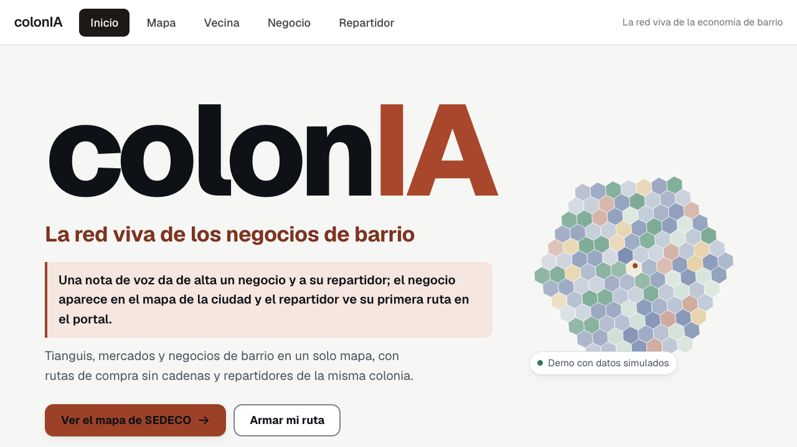
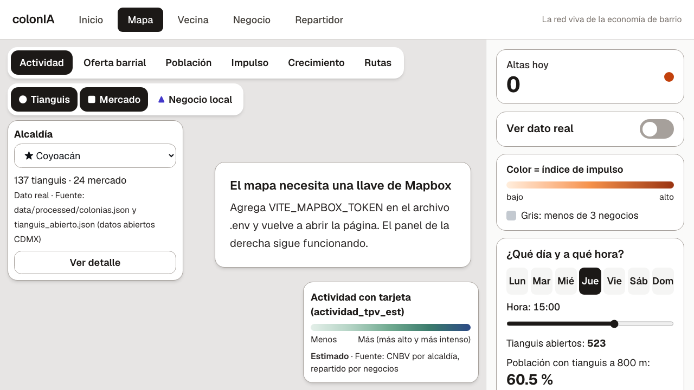
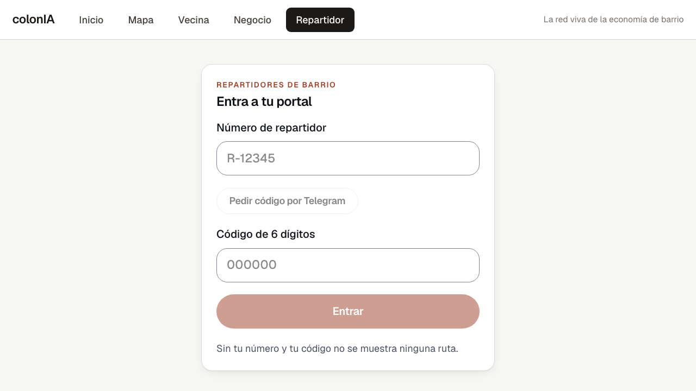

<div align="center">



# colonIA

## La red viva de la economía de barrio

**Una nota de voz da de alta un negocio de barrio; aparece en el mapa de la ciudad y su repartidor de la misma colonia ve su primera ruta.**

Mapa de tianguis, mercados y negocios locales de la CDMX, rutas de compra sin cadenas y un portal de repartidores con incentivos. La IA solo extrae campos; las cifras y las rutas las calcula código determinista.


-orange)


[Pruébalo](#pruébalo-en-30-segundos) · [El problema](#el-problema) · [Qué hace](#qué-hace) · [Cómo funciona la IA](#cómo-funciona-la-ia) · [Datos](#datos-reales-vs-simulados) · [Estructura](#estructura-del-repo) · [Llaves](#llaves-y-variables) · [Agentic Kit](#cómo-se-coordinó-el-equipo-upiixia-agentic-kit)

</div>

---

## What is colonIA

colonIA is a living map of neighborhood commerce in Mexico City. A shop owner sends a voice note to a Telegram bot; an LLM extracts structured fields (name, trade, address, delivery person), and the shop appears on the map next to 1,367 street markets (tianguis) and 329 public markets from open data. Shoppers get a route that avoids chain stores; local couriers get a portal with incentives. **The LLM only extracts fields: every number and every route is deterministic code, and every figure carries a `tipo_dato` (`real`, `estimado` or `simulado`).**

## Pruébalo en 30 segundos

Sin internet ni llaves (respuestas grabadas; necesita `uv` y Node):

```bash
git clone git@github.com:rvvictor/HackADA-Upiixia.git && cd HackADA-Upiixia && DEMO_MODE=1 bash scripts/demo.sh
```

Abre http://127.0.0.1:8000 · SEDECO `#/sedeco` · Vecina `#/usuario` · Negocio `#/negocio` · Repartidor `#/repartidor`.

App en vivo: **https://colonia-hackada.onrender.com** (plan gratuito: la primera visita tarda ~1 min en despertar).

El alta por nota de voz también se simula sin Telegram: `uv run python scripts/simular_alta.py --caso dona-lupe --url http://127.0.0.1:8000`.

## Sin colonIA / Con colonIA

| Sin colonIA | Con colonIA |
|---|---|
| El negocio de barrio no existe en ningún mapa | Se da de alta con una nota de voz en Telegram |
| Comprar local obliga a recorrer la colonia a ciegas | Ruta de compras sin cadenas, con tianguis abiertos hoy |
| El repartidor no tiene pedidos ni ruta cerca de casa | Portal de repartidores de la misma colonia, con incentivos |
| SEDECO decide con datos sueltos | Un mapa con actividad, oferta barrial, impulso y crecimiento, cada cifra con su fuente |

## El problema

Los tianguis, mercados y tienditas sostienen el abasto de las colonias, pero casi no aparecen en mapas ni plataformas, y los pedidos a domicilio se los quedan las cadenas. Sin datos visibles es difícil comprar local, repartir local o priorizar apoyos.

## Qué hace



*Captura sin `VITE_MAPBOX_TOKEN`: el mapa base pide la llave y el panel lateral sigue funcionando.*

- **Mapa** (`#/mapa`): tianguis, mercados y negocios locales; capas de actividad, oferta barrial, población, impulso, crecimiento y rutas; filtro por día y hora.
- **Alta por nota de voz en Telegram:** el negocio manda un audio, se transcribe y se extraen los campos; queda en el mapa (`app/bot/`, `app/routers/altas.py`).
- **Ruta de compras** (`#/usuario`): ruta sin cadenas entre negocios locales (`app/routers/ruta.py`).
- **Portal de repartidores** (`#/repartidor`): entra con número de repartidor y código de 6 dígitos; ve ofertas cercanas e incentivos (`app/routers/repartidores.py`, `app/routers/incentivos.py`).



## Cómo funciona la IA

1. **El LLM solo extrae campos** de la nota de voz transcrita (nombre, giro, colonia, repartidor). No inventa cifras ni rutas.
2. **Las cifras y las rutas son código determinista** (`app/services/`): alcance a 800 m, población con tianguis, índice de impulso, distancia de ruta.
3. **Cada dato lleva `tipo_dato`** (`real`, `estimado`, `simulado`) y `fuente`; la interfaz los muestra junto a la cifra.
4. **Plan B sin red:** con `DEMO_MODE=1` las respuestas del LLM y de Mapbox son grabadas (`app/fixtures/`).

## Datos reales vs simulados

Fichas de fuente en `data/fuentes/*.md`; salidas en `data/processed/`.

| Dato | Cifra | `tipo_dato` | Fuente |
|---|---|---|---|
| Tianguis | 1,367 | real | Datos abiertos CDMX (`data/fuentes/tianguis.md`) |
| Mercados públicos | 329 | real | Datos abiertos CDMX (`data/fuentes/mercados.md`) |
| Colonias | 1,543 | real | Catálogo de colonias CDMX (`data/fuentes/colonias.md`) |
| Marginación por colonia | 849 colonias cruzadas de 2,243 en CONAPO 2020 | real | CONAPO (`data/fuentes/marginacion.md`) |
| Negocios locales | 59,871 (consulta del 2026-10-29) | real | INEGI, DENUE (`data/fuentes/denue.md`) |
| Población por hexágono | totales inventados | simulado | `data/fuentes/geo.md` |
| Negocios por hexágono, programas, ventas | derivados de la población simulada | simulado | `data/fuentes/geo.md`, `data/fuentes/negocios.md` |
| Dinero con tarjeta (CNBV) | totales por alcaldía inventados | simulado | `data/fuentes/geo.md` |

## Estructura del repo

```
app/        API FastAPI: routers/, services/, schemas/, bot/ (Telegram), tests/
web/        React + Vite + Tailwind (features: inicio, mapa, usuario, negocio, repartidor)
pipeline/   Procesamiento de datos abiertos, DENUE y negocios (con pruebas)
data/       fuentes/ (fichas), processed/ (salidas JSON/GeoJSON)
scripts/    demo.sh, simular_alta.py, simular_repartidor.py, generar_historia.py
docs/       entregables/, pitch/, media/ (capturas de este README)
.uak/       Agentic Kit: tareas, reglas y coordinación del equipo
```

## Llaves y variables

Se configuran en `.env` (no versionado; plantilla en `.env.example`). Solo nombres:

`OPENAI_API_KEY` · `MAPBOX_TOKEN` · `VITE_MAPBOX_TOKEN` · `TELEGRAM_BOT_TOKEN` · `DENUE_TOKEN`

Sin llaves, `DEMO_MODE=1` ejecuta todo con respuestas grabadas.

## Cómo se coordinó el equipo (UPIIXIA Agentic Kit)

colonIA se construyó con el [UPIIXIA Agentic Kit](https://github.com/JoahanMorales/upiixia-agentic-kit): varios agentes de IA por cada persona del equipo trabajando en paralelo, sin servidor, solo con una rama de Git (`claims`) y Bash.

- **Un agente por humano, una tarea por agente:** cada tarea tiene su rama, su worktree y su claim (`bash .uak/bin/wt new ID`).
- **Claims y archivos reservados:** nadie edita archivos de otra tarea; se pide por mensaje (`uak msg`).
- **Revisión cruzada:** el autor nunca revisa; otro agente revisa el SHA exacto y corre el `Verify` de la tarea.
- **Merges con compuerta:** solo se integra lo aprobado (`uak merge`); sin force-push ni borrado del trabajo ajeno.
- **Bucles acotados:** implementar, verificar, corregir; tras 2 fallos idénticos la tarea se marca BLOCKED.

El backlog está en `.uak/TASKS.md` y las reglas en `AGENTS.md`.
