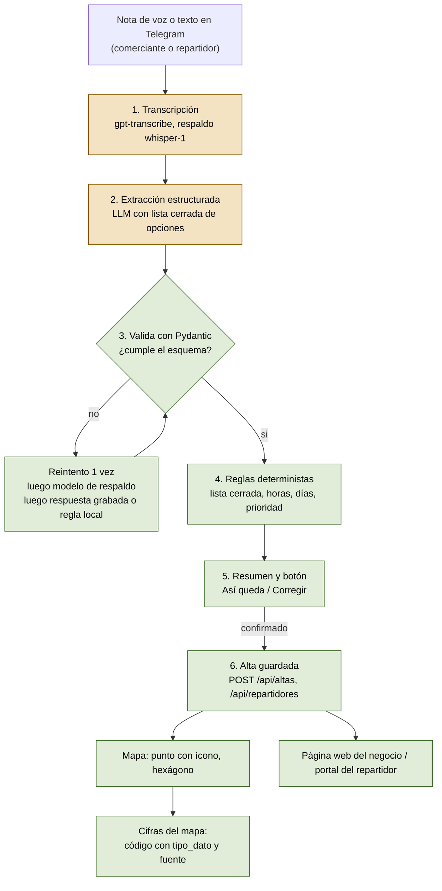

# Flujo de IA

De una nota de voz a un negocio en el mapa. El modelo interpreta lenguaje; el código decide y calcula.

## Diagrama

Los pasos 1 y 2 (ámbar) son los únicos donde decide un modelo. Todo lo demás (verde) es código.

## Paso a paso

| # | Paso | Quién decide | Dónde está | Estado |
|---|---|---|---|---|
| 1 | La persona manda una nota de voz o escribe | Persona | Bot de Telegram (`app/bot/`) | en `main` |
| 2 | Voz a texto | **Modelo** (`OPENAI_TRANSCRIBE_MODEL`, respaldo `whisper-1`) | `app/services/altas.py::transcribir` | en `main` |
| 3 | Texto a campos (nombre, giro, productos, horario, pagos) | **Modelo**, con salida estructurada y lista cerrada de giros | `altas.py::extraer_ficha` | en `main` |
| 4 | Validación del esquema | Código (Pydantic) | `altas.py::Ficha` | en `main` |
| 5 | Corrección con listas cerradas: clave SCIAN válida o `999999`, días 0 a 6 ordenados, giro tomado de la lista | Código | `altas.py::extraer_ficha` | en `main` |
| 6 | Resumen y confirmación | Persona (toca **Así queda**) | `altas.py::ficha_texto`, bot | en `main` |
| 7 | Alta, punto en el mapa, hexágono H3, tianguis cercano a 150 m | Código | `altas.py::crear_alta` | en `main` |
| 8 | Página web del negocio | Código (plantilla fija, sin modelo) | `negocio.py::descripcion`, `paginas.py` | en `main` |
| 9 | Alta del repartidor, un campo por mensaje, mismo patrón (voz, extracción, validación, regla local) | **Modelo** solo para extraer el campo | `repartidor_dialogo.py` | rama `feat/co-009`, en revisión |
| 10 | Prioridad del repartidor y orden de ofertas | Código | `repartidor_dialogo.py::prioridad` y API de ofertas | prioridad en `feat/co-009`; ofertas en curso |
| 11 | Lista del mandado a giros | Diccionario, similitud difusa y, solo si fallan, **modelo** con lista cerrada | `app/services/articulos.py` | en `main` |
| 12 | Ruta de compras: candidatos, puntaje, desvío máximo, cobertura, orden de paradas | Código; Mapbox si hay token, vecino más cercano si no | `app/services/ruta.py`, `mapbox.py` | en `main` |
| 13 | Cifras del mapa (actividad, impulso, desiertos) | Código, con `tipo_dato` | `app/services/mapa.py`, `pipeline/` | en `main` |

## Dónde decide el modelo

1. **Entender lo que la persona dijo** y llevarlo a campos: "de 7 a 3 de lunes a sábado, acepto DiMo" se vuelve días `[0..5]`, `07:00` a `15:00`, `dimo`. Una regla no cubre todas las formas de hablar de la gente.
2. **Elegir un giro de una lista cerrada** cuando el comerciante describe su negocio con sus palabras, y clasificar un artículo raro de la lista del mandado.
3. **Extraer un solo dato por pregunta** en el alta del repartidor (nombre, edad, si estudia, alcaldía, colonias, transporte, disponibilidad).

## Dónde NO decide el modelo

- **Ninguna cifra visible la produce el modelo.** Población, negocios, dinero, actividad, impulso, distancias, tiempos, pagos estimados y conteos salen de datos y código, y cada una viaja con `tipo_dato` (`real`, `estimado` o `simulado`) que la interfaz muestra.
- **Rutas**: qué negocios entran, en qué orden y por dónde van es código. La regla anti-cadenas se aplica antes y una prueba falla si alguna parada fuera una cadena (`RutaConCadena`).
- **Prioridad de repartidores**: `prioridad = 2` si tiene 18 a 30 años y estudia, `1` si cumple una, `0` si ninguna. La calcula el código y solo actúa al ordenar ofertas (`prioridad`, luego cercanía, luego antigüedad). Nadie queda excluido. Ver `docs/legal/priorizacion.md`.
- **Verificación de identidad**: no la hace un modelo. En demo está simulada (`demo_data: true`).
- **Lo que se publica**: nada sale a la web sin que la persona toque **Así queda**.
- **Qué hacer si el modelo falla**: nada se inventa. Se reintenta, se usa el modelo de respaldo, y al final una respuesta grabada o una regla local.

## Trazabilidad

Cada dato visible lleva su `tipo_dato` y su fuente (`data/fuentes/`). Lo que viene de una nota de voz es `real de plataforma` hasta que alguien lo verifica; en la demo, los datos de ejemplo llevan `demo_data: true`.
